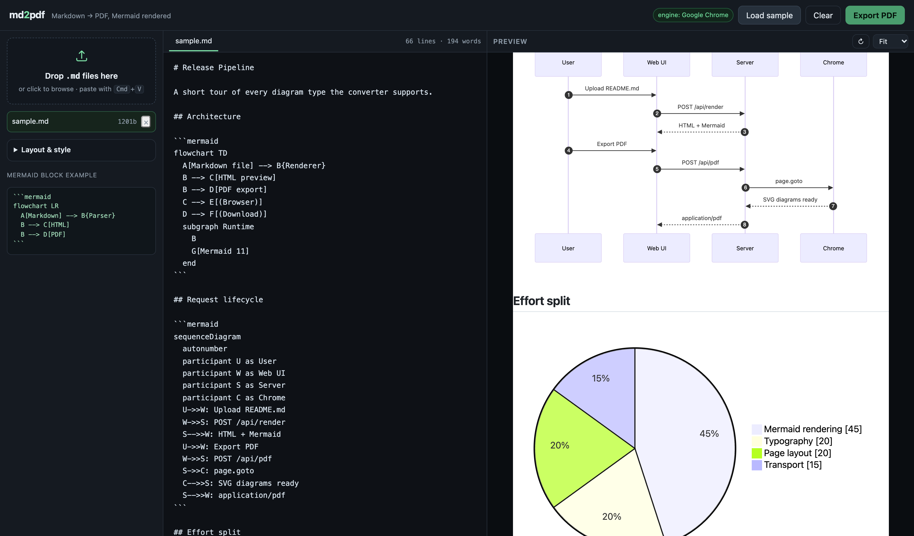
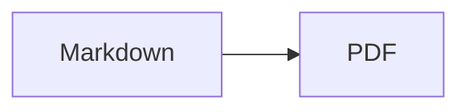

# md2pdf

[](LICENSE)

Self-hosted web app: upload Markdown, preview it as real pages, export a PDF. Mermaid
fences are rendered as actual vector diagrams inside the PDF, not as code blocks.

No uploads to a third party, no CDN, no telemetry. Everything runs on your machine.



## Why

Most Markdown-to-PDF pipelines treat a Mermaid block as a code fence and print the
syntax. This one runs Mermaid in the same headless Chrome that prints the page, so
flowcharts, sequence diagrams, Gantt charts, class and state diagrams land in the PDF
as scalable SVG.

## Run

```bash
npm install
npm start
```

Open http://localhost:4321

Needs a local Chrome or Chromium for PDF output. The server finds it automatically on
macOS and the usual Linux paths. Override if needed:

```bash
CHROME_PATH=/path/to/chrome npm start
PORT=8080 npm start
```

The status pill in the header shows which browser was picked up, or a warning if none
was found.

## Using it

Drop `.md` files anywhere on the page, click the drop zone, or paste with Cmd+V.
Multiple files become one PDF, each starting on a fresh page. Files and settings persist
in localStorage, so a reload keeps your work.

Export PDF (or Cmd+S) renders server side and downloads the file. The toast reports how
many Mermaid diagrams rendered.

### Diagram blocks

````

````

`mermaid` and `mmd` are both accepted as the fence language. A block with a syntax error
does not abort the export: the PDF gets a red placeholder with the error and the source,
and the toast tells you how many failed.

### Layout options

Page size (A4, Letter, Legal, A5, A3, Tabloid), orientation, margins, font family
(sans, serif, mono), text scale, accent colour, light or dark document theme, and five
Mermaid themes. Cover page, table of contents, footer, page numbers, and preview page
guides are each toggleable. A base URL for relative image paths can be set so
`` resolves.

The preview draws dashed lines at the real page boundaries, so you can see where Chrome
will break the document before exporting.

## How it works

1. `POST /api/render` returns HTML built by markdown-it with `mermaid` fences rewritten
   to `<pre class="mermaid">`.
2. The browser loads Mermaid 11 from `/vendor` and replaces those nodes with SVG. It
   posts its page dimensions back to the UI, which is how the preview scales.
3. `POST /api/pdf` builds the same HTML, hands it to a headless Chrome page, waits for
   `window.__ready`, then calls `page.pdf()` with `printBackground` and CSS page size.

One renderer for preview and export means what you see is what prints.

| Route | Purpose |
| --- | --- |
| `GET /` | UI |
| `POST /api/render` | HTML for preview |
| `POST /api/pdf` | PDF binary (`files` multipart, `options` JSON) |
| `GET /api/health` | Browser detection |

## Notes

Everything is local. No uploads to a third party, no CDN, no telemetry. Files are held
in memory for the duration of a render and discarded.

Markdown is rendered with `html: true`, matching GitHub's behaviour. If you render
untrusted Markdown, run the server on a network you control.

## Requirements

Node 18+ and a local Chrome or Chromium. No database, no build step, no bundler.

## License

MIT. See [LICENSE](LICENSE).
